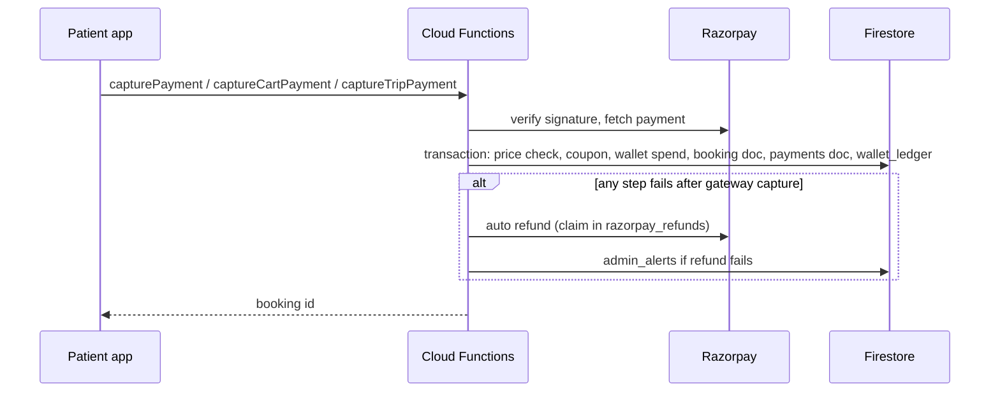
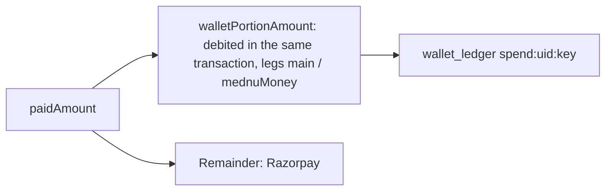
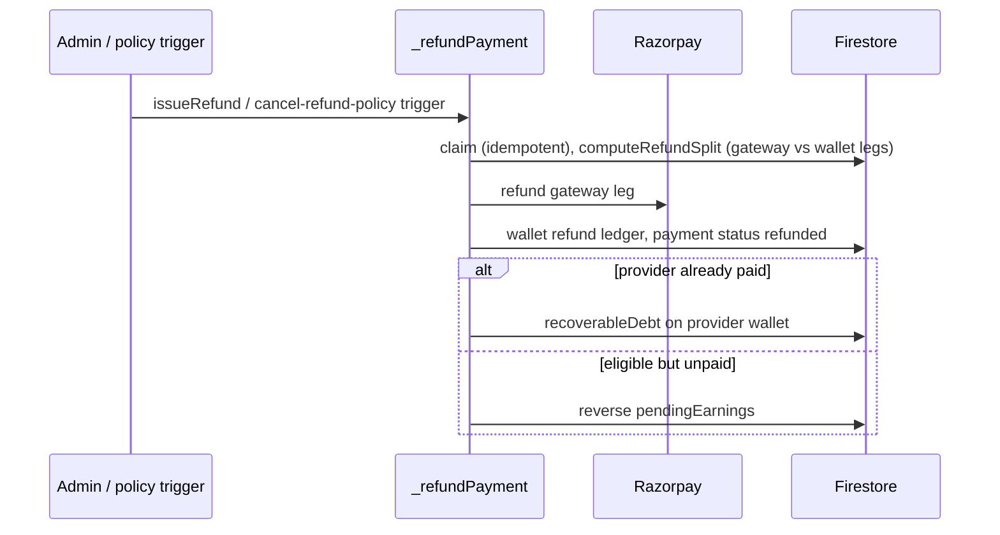
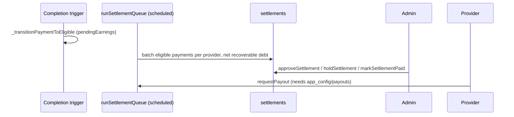

# MedNu architecture

See also: `docs/DATA_MODEL.md` (collections), `docs/BACKUP_AND_ROLLBACK.md`,
`functions/DEPLOY.md`, `HANDOVER_CLIENT.md` (client-facing money model),
`GO_LIVE_CHECKLIST.md`. Unverified statements are marked **to verify**.

## 1. Repo map

| Path | What it is |
|---|---|
| `mednu/` | Patient Flutter app. Home screen is design-frozen (see `CLAUDE.md`). |
| `mednu_doctor/` | Partner Flutter app ("MedNu Doctor" / "MedNu Service"): doctors, labs, pharmacies, equipment, ambulance, nurses, care assistants, physio, counsellors, dieticians, hospitals. Shared partner code in `lib/shared_core/` (documents, wallet). |
| `mednu_web/` | Flutter web target (Firebase hosting target `web`). |
| `mednu-admin/` | Admin web panel (plain JS: `js/app.js`, `panel.js`, `web-ads.js`; hosting target `admin`). |
| `functions/` | Cloud Functions (Node, `index.js` with ~156 exports; helpers `price_helpers.js`, `plan_helpers.js`, `razorpay_refund_helpers.js`, `ambulance_match_helpers.js`; `whatsapp/`; `scripts/` one-off migrations; `test/` server-logic tests). |
| `firestore.rules`, `storage.rules`, `firestore.indexes.json` | Security rules and indexes. |
| `firestore-tests/` | Rules test suite (emulators). |
| `shared/` | Cross-language test data (`fee_cases.json`). |
| `codemagic.yaml` | iOS builds. `.github/workflows/ci.yml` runs tests. |

## 2. Role model

- Patients: Firebase Auth users with a `users/{uid}` doc.
- Partners: Firebase Auth users with one `*_profiles/{uid}` doc per role; the
  profile must be approved by an admin after documents are verified.
- Admins: `admins/{uid}` exists (rules `isAdmin()`); `role` in `director`,
  `hr`, `finance`, `support`, `marketing`, default `director`. Rules helpers
  `adminRole()`, `isDirector()`, `adminInRoles([...])` gate writes; the admin
  UI mirrors the access in `ROLE_TAB_ACCESS` (`mednu-admin/js/app.js`). Both
  lists are maintained by hand.
- Server: Cloud Functions use the Admin SDK and bypass rules. Callables use
  `enforceAppCheck: true`.

## 3. The id-linked chain

    service_requests/{requestId}            (pool jobs; type, patientId, status)
        -> pool doc (orders, ambulance_requests, caregiver_visits, ...)   (created by on*ServiceRequestCreated; carries requestId, **to verify** exact field)
        -> payments/{paymentId}             booking doc stores paymentId; payment stores bookingRef {collection,id}
        -> wallet_ledger                    docs with source "payment:<paymentId>:..." (deterministic ids)
        -> provider_wallets/{providerId}    pendingEarnings, balances
        -> settlements/{id}                 payments carry settlementId; settlement lists paymentIds (**to verify**)
        -> payout request / payout          created by requestPayout (**to verify** collection)

Direct bookings (appointments, consultations, nutrition) skip the first two
hops: the booking doc itself carries `paymentId`. Searching Cloud Logging for
`paymentId` or `requestId` follows one booking end to end.

## 4. Money flows

Fee model: the provider receives the base price (minus coupon); the platform
earns a flat per-service `platformFee`; `commission` is always 0.

### 4.1 Booking and capture

Fee split: `_computeProviderSplit` (provider gets paid minus fee, coupon reduces the
provider share). Fee lookup: provider override, then service, then default
(`price_helpers.platformFeeFor`, mirrored in Dart).

### 4.2 Wallet plus gateway split

### 4.3 Refund

### 4.4 Settlement and payouts

### 4.5 Weight-loss plans
Plan purchase creates `nutrition_subscriptions/plansub:<paymentId>` and holds
the payment (`settlementStatus: plan_hold`). Each completed consultation
releases its equal share through a child `payments` doc
(`_completePlanConsultation`); lapsed windows and reversals are ledgered
(`plan_lapse:`, `plan_reversal:`). Windows come from `plan_helpers.js`.

### 4.6 Ambulance
Request is created as a `service_requests` doc, trigger matches drivers by
vehicle type (`ambulance_match_helpers.js`), `reassignStaleAmbulanceAssignments`
re-offers stale ones, pay-after-trip uses `captureTripPayment`,
`remindUnpaidAmbulanceTrips` reminds and `markTripWrittenOff` closes bad debt.
Full state machine: **to verify** in `onAmbulanceRequestStatusChange`.

## 5. Notification routing

Status-change triggers (`on*StatusChange`, `on*ServiceRequestCreated`) call
helpers such as `_sendProviderNotification(db, messaging, providerId, opts)`
which write an inbox doc (`patient_notifications/{uid}/items`,
`provider_notifications`, `doctor_notifications`) and send FCM to tokens stored
on the target user / profile doc. Hospital service types resolve a catalogue id
to the billing-desk uid(s). Notification failures are swallowed on purpose
(they must not fail a money transaction). Broadcasts: `onBroadcastCreated`.
WhatsApp messages: `functions/whatsapp/` (`waWebhook`, reminders, order/payment
triggers).

## 6. Config switches

Documented in `docs/DATA_MODEL.md` section 4 and `docs/BACKUP_AND_ROLLBACK.md`
section 5. In the apps, `PaymentConfig.requirePayment` reads
`app_config/payments` live; the compile-time `kRequirePayment` is only the
fallback until the doc loads.

## 7. Testing map

| Suite | Run | Covers |
|---|---|---|
| `functions/test` | `node functions/test/run_all.js` | Money paths through an in-memory Firestore (`money.test.js`, `payouts.test.js`) and pure helpers (`test/unit/*.test.js`) including Dart/JS fee parity |
| `firestore-tests` | emulators (see `README.md`) | Rules per collection |
| Flutter | `flutter test` in `mednu/`, `mednu_doctor/` | Fee parity, weight-loss helpers, partner document checklist, dental rule |
| CI | `.github/workflows/ci.yml` | JS syntax, server tests, rules (advisory), analyze and tests per app |

Not covered: onCall capture paths needing signed Razorpay payloads, concurrency
retries, push delivery, most UI.

## 8. Debugging guide

| Symptom | Where to look |
|---|---|
| Paid but no booking | Function logs for `capturePayment` / `captureCartPayment` (`firebase functions:log --only capturePayment`), `razorpay_payments`, `payments/{paymentId}`, then the booking; `reconcileRazorpayPayments` refunds orphans; check `admin_alerts` |
| Price mismatch rejections | `price_mismatch` log events (`_logSettlement`), `settlement_config/global.enforcePriceCheck`, parity between Dart fee code and `price_helpers.js` |
| Refund problems | `_refundPayment` logs, `razorpay_refunds/{paymentId}` claim, payment `refund*` fields, provider wallet `recoverableDebt` |
| Provider not credited | payment `settlementStatus` (`pending` -> `eligible`), completion trigger logs, `wallet_ledger` by `source` |
| Settlement or payout stuck | `settlements` status, `runSettlementQueue` logs, `audit_logs`, `app_config/payouts` |
| permission-denied in an app | Reproduce in `firestore-tests` with the same auth and docs; check the role helpers at the top of `firestore.rules` |
| Push not delivered | Trigger logs, FCM tokens on the user / profile doc, FCM error codes |
| App crash | Crashlytics (both apps) |
| Admin action effects | `audit_logs` (money and callable actions); direct `app_config` edits are not audited |
